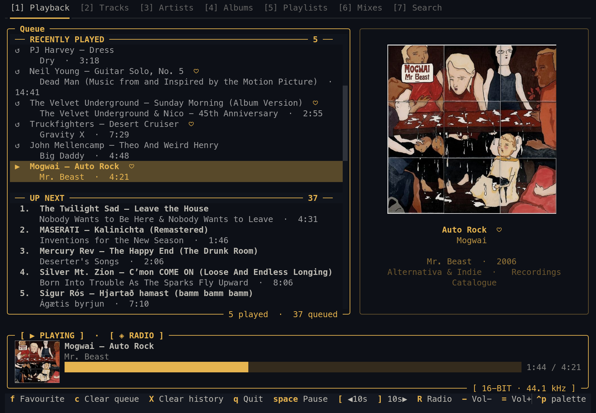

<div align="center">


# qobit

[](https://github.com/pierdom/qobit/actions/workflows/ci.yml)
[](https://github.com/pierdom/qobit/releases)
[](LICENSE)
[](pyproject.toml)
[](https://github.com/astral-sh/uv)
[](https://github.com/astral-sh/ruff)
[](https://textual.textualize.io)
[](#install)

A bit-perfect Qobuz client with a terminal UI, for Linux and macOS.

</div>

qobit plays hi-res FLAC from Qobuz through mpv with no resampling and no DSP.
The output device runs at each track's own sample rate and bit depth, and the
DAC receives exactly the bits from the file. You browse your library and
control playback from a keyboard-driven terminal UI with cover art.

<div align="center">

 

</div>

## Features

- Bit-perfect output through PipeWire rate-following or exclusive ALSA `hw:` /
  CoreAudio devices. Tracks your account can only preview (30-second MP3s) are
  skipped.
- Favourite tracks, artists and albums, and your playlists, with sorting and a
  live filter.
- A queue you can move back and forth in without losing tracks. It's restored
  when you restart qobit.
- Song radio and personal DailyQ / WeeklyQ mixes from Qobuz recommendations.
- Cover art and artist bios, drawn with the Kitty graphics protocol (see
  [Terminal](#terminal)).
- Themes, including Ayu Dark, Mirage and Light.
- OS media keys and now-playing widgets (MPRIS on Linux, Now Playing on macOS).
- Qobuz Connect (off by default): qobit shows up as a device in the Qobuz apps,
  and you can control it from there.

## Install

Requirements: a Qobuz subscription (Hi-Res for 24-bit), Python 3.11+,
[uv](https://docs.astral.sh/uv/), [mpv](https://mpv.io/), and a terminal that
supports the Kitty graphics protocol (see [Terminal](#terminal)).

On Linux, the media-key support builds against system headers. Install them
first:

```bash
# Debian / Ubuntu 24.04+
sudo apt install mpv build-essential pkg-config python3-dev libcairo2-dev libgirepository-2.0-dev
# Fedora 40+
sudo dnf install mpv gcc pkgconf-pkg-config python3-devel cairo-devel cairo-gobject-devel gobject-introspection-devel
# Arch
sudo pacman -S --needed mpv base-devel pkgconf cairo gobject-introspection
```

Then:

```bash
git clone https://github.com/pierdom/qobit && cd qobit
uv tool install .
qobit auth          # log in once; opens the browser
qobit set-device    # choose the audio output
qobit               # start the TUI
```

For bit-perfect output, choose the device as described in
[docs/audio.md](docs/audio.md).

## Terminal

qobit draws all images (cover art, artist photos) with the
[Kitty graphics protocol](https://sw.kovidgoyal.net/kitty/graphics-protocol/).
There is no fallback for other terminals.

| Terminal | Images |
|---|---|
| [kitty](https://sw.kovidgoyal.net/kitty/) | works |
| [Ghostty](https://ghostty.org) | works |
| [WezTerm](https://wezterm.org), Konsole | implement the protocol; not tested with qobit |
| Inside tmux | needs `set -g allow-passthrough on`; not tested with qobit |

> [!WARNING]
> In other terminals (GNOME Terminal, iTerm2, macOS Terminal, Alacritty,
> Windows Terminal, VS Code, …) every image shows up as blocks of garbled
> characters, so qobit looks very bad. Playback still works, but use one of the
> terminals above.

## Usage

| Key | Action | Key | Action |
|---|---|---|---|
| `1`–`7` | switch tab | `Space` | pause / resume |
| `/` | filter | `[` `]` | seek 10 s |
| `s` `r` | sort, reverse | `R` | song radio |
| `i` | menu: queue, favourite, follow | `g` | go to artist / album |
| `f` | favourite | `Ctrl+P` | command palette |

All keys, and how each tab works, are in [docs/usage.md](docs/usage.md).
From the command line:

```bash
qobit play "Kind of Blue"   # search, play the first result, check the output format
qobit devices               # list audio outputs
qobit --connect-on          # start with Qobuz Connect enabled for this run
```

## Documentation

| | |
|---|---|
| Keys, tabs, radio, mixes, Qobuz Connect, files | [docs/usage.md](docs/usage.md) |
| Audio setup and bit-perfect output | [docs/audio.md](docs/audio.md) |
| PipeWire configuration | [contrib/pipewire](contrib/pipewire/README.md) |
| Qobuz Connect protocol notes | [docs/qobuz-connect.md](docs/qobuz-connect.md) |
| Qobuz Connect implementation | [docs/qobuz-connect-design.md](docs/qobuz-connect-design.md) |
| Changes | [CHANGELOG.md](CHANGELOG.md) |
| Contributing | [CONTRIBUTING.md](CONTRIBUTING.md) |
| Notes for working on the code | [CLAUDE.md](CLAUDE.md) |

## Development

```bash
uv sync --group dev
uv run pytest
uv run ruff check . && uv run ruff format --check .
```

## Why this exists

This is a personal project. [qbz](https://github.com/vicrodh/qbz) by vicrodh is
a more complete Qobuz player with a graphical UI, and qobit borrows its
bit-perfect approach. [qobine](https://github.com/SofusA/qobine) is a lighter
terminal client. I wanted a Qobuz client that looks good on a cyberdeck build,
with large cover art and a terminal UI.

The Qobuz Connect support is based on the protocol work in
[qobuz-connect](https://github.com/ciaens/qobuz-connect) and
[qobuz-proxy](https://github.com/leolobato/qobuz-proxy).

## Disclaimer

qobit is not affiliated with or endorsed by Qobuz. It uses the same API as the
Qobuz web player, requires your own subscription, and only plays what your
account can stream. It is an early-stage project. Use it at your own risk and
within Qobuz's terms of service.

## License

GPL-3.0. See [LICENSE](LICENSE).
