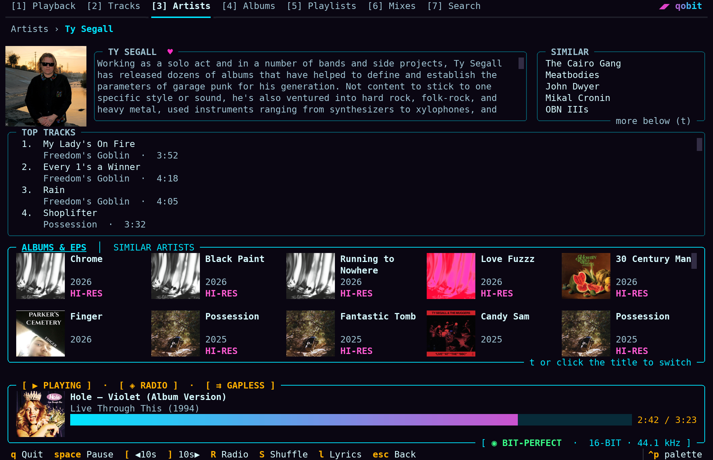

<div align="center">


# qobit

[](https://github.com/pierdom/qobit/actions/workflows/ci.yml)
[](https://github.com/pierdom/qobit/releases)
[](https://github.com/pierdom/qobit/blob/main/LICENSE)
[](https://github.com/pierdom/qobit/blob/main/pyproject.toml)
[](https://github.com/astral-sh/uv)
[](https://github.com/astral-sh/ruff)
[](https://textual.textualize.io)
[](#install)

A bit-perfect Qobuz client for the terminal, on Linux and macOS.

</div>

> [!NOTE]
> qobit is an unofficial project. It is not affiliated with, endorsed by or
> sponsored by Qobuz. See [Disclaimer](#disclaimer).

qobit is a Qobuz player for Linux and macOS that runs in the terminal, with a
rich TUI. It streams hi-res FLAC from Qobuz and plays it through mpv, with no
resampling and no DSP. The output device runs at each track's own sample rate
and bit depth, so the DAC gets exactly the bits from the file. You browse your
Qobuz library, playlists and mixes with the keyboard, and see cover art in the
terminal.

It works best in Ghostty or kitty (see [Terminal](#terminal)).

<div align="center">

 

</div>

## Features

- Bit-perfect output through PipeWire (following each track's sample rate) or
  exclusive ALSA `hw:` / CoreAudio devices. An indicator checks it on every
  track; on Linux it reads the rate the DAC actually runs at. Tracks your
  account can only preview (30-second MP3s) are skipped.
- Gapless playback, on by default. A change of sample rate reopens the output:
  qobit never resamples.
- Favourite tracks, artists and albums, and your playlists, with sorting and a
  live filter. Add favourites and follow artists from any list with `i`.
- A queue you can move back and forth in without losing tracks. It's restored
  when you restart qobit.
- Shuffle (`S`).
- Synced lyrics from LRCLIB, shown beside the now-playing panel when the
  terminal is big enough (`l`). Each lookup sends the track's artist, title,
  album and length to lrclib.net; `--no-lyrics` or the command palette turns
  it off.
- Song radio and personal DailyQ / WeeklyQ mixes from Qobuz recommendations.
- Artist pages with top tracks, your favourites by that artist, albums and
  similar artists.
- Cover art and artist bios. Art is sharp in terminals with the Kitty graphics
  protocol and drawn with coloured blocks elsewhere (see [Terminal](#terminal)).
- Themes, including Ayu Dark, Mirage and Light.
- OS media keys and now-playing widgets (MPRIS on Linux, Now Playing on macOS).
- Qobuz Connect (off by default): qobit shows up as a device in the Qobuz apps,
  and you can control it from there.

## Install

Requirements: a Qobuz subscription (Hi-Res for 24-bit), Python 3.11+,
[uv](https://docs.astral.sh/uv/), [mpv](https://mpv.io/), and a terminal with
true colour. For sharp cover art, use one with the Kitty graphics protocol (see
[Terminal](#terminal)).

Install mpv and uv first:

```bash
# macOS (Homebrew)
brew install mpv uv
# Debian / Ubuntu
sudo apt install mpv
# Fedora
sudo dnf install mpv
# Arch
sudo pacman -S mpv
```

(On Linux, get uv from your package manager or the
[installer](https://docs.astral.sh/uv/getting-started/installation/).)

Then:

```bash
uv tool install qobit   # or: pipx install qobit
qobit auth              # log in once; opens the browser, prints the link
qobit set-device        # choose the audio output
qobit                   # start the TUI
```

Upgrade with `uv tool upgrade qobit`. To run the latest code from `main`
instead: `uv tool install git+https://github.com/pierdom/qobit`.

For bit-perfect output, choose the device as described in
[docs/audio.md](https://github.com/pierdom/qobit/blob/main/docs/audio.md).

## Terminal

qobit picks how to draw cover art and artist photos from what your terminal
supports:

| Terminal | Cover art |
|---|---|
| [kitty](https://sw.kovidgoyal.net/kitty/), [Ghostty](https://ghostty.org) | sharp images ([Kitty graphics protocol](https://sw.kovidgoyal.net/kitty/graphics-protocol/)) |
| Any other terminal with true colour (GNOME Terminal, iTerm2, Alacritty, WezTerm, Konsole, …) | coloured blocks: low resolution, but recognisable |

Inside tmux, sharp images need `set -g allow-passthrough on` in kitty or
Ghostty; without it, qobit uses blocks.

You can choose yourself with `qobit --images MODE` (for one run) or from the
command palette (`Ctrl+P`, then "Images", saved):

- `auto`: the default, as in the table above.
- `kitty`: always use the Kitty graphics protocol.
- `blocks`: always use coloured blocks.
- `off`: show initials instead of cover art and download no covers. Use it if
  qobit feels slow on an older machine.

## Usage

| Key | Action | Key | Action |
|---|---|---|---|
| `1`–`7` | switch tab | `Space` | pause / resume |
| `/` | filter | `[` `]` | seek 10 s |
| `s` `r` | sort, reverse | `R` `S` | song radio, shuffle |
| `l` `L` | lyrics (panel, full screen) | | |
| `i` | menu: queue, favourite, follow | `g` | go to artist / album |
| `f` | favourite | `Ctrl+P` | command palette |

All keys, and how each tab works, are in [docs/usage.md](https://github.com/pierdom/qobit/blob/main/docs/usage.md).
From the command line:

```bash
qobit play "Kind of Blue"   # search, play the first result, check the output format
qobit devices               # list audio outputs
qobit --connect-on          # start with Qobuz Connect enabled for this run
qobit --shuffle             # shuffle for this run
qobit --no-gapless          # no gapless playback for this run
qobit --no-lyrics           # no lyrics (and no lookups) for this run
```

## Documentation

| | |
|---|---|
| Keys, tabs, radio, mixes, Qobuz Connect, files | [docs/usage.md](https://github.com/pierdom/qobit/blob/main/docs/usage.md) |
| Audio setup and bit-perfect output | [docs/audio.md](https://github.com/pierdom/qobit/blob/main/docs/audio.md) |
| PipeWire configuration | [contrib/pipewire](https://github.com/pierdom/qobit/blob/main/contrib/pipewire/README.md) |
| Qobuz Connect protocol notes | [docs/qobuz-connect.md](https://github.com/pierdom/qobit/blob/main/docs/qobuz-connect.md) |
| Qobuz Connect implementation | [docs/qobuz-connect-design.md](https://github.com/pierdom/qobit/blob/main/docs/qobuz-connect-design.md) |
| Changes | [CHANGELOG.md](https://github.com/pierdom/qobit/blob/main/CHANGELOG.md) |
| Contributing | [CONTRIBUTING.md](https://github.com/pierdom/qobit/blob/main/CONTRIBUTING.md) |
| Reporting a security issue | [SECURITY.md](https://github.com/pierdom/qobit/blob/main/SECURITY.md) |
| Notes for working on the code | [CLAUDE.md](https://github.com/pierdom/qobit/blob/main/CLAUDE.md) |

## Development

```bash
uv sync --group dev
uv run pytest
uv run ruff check . && uv run ruff format --check .
```

## Why this exists

This is a personal project. I wanted a Qobuz client that looks good on a
cyberdeck build, with large cover art and a terminal UI.

qobit builds on other people's work:

- [qbz](https://github.com/vicrodh/qbz) by vicrodh, a full-featured Qobuz
  desktop player and the main source and inspiration for qobit, including its
  bit-perfect approach. qbz has been discontinued and its code is no longer
  available.
- [qobine](https://github.com/SofusA/qobine) by SofusA, a lighter terminal
  client for Qobuz.
- [qobuz-connect](https://github.com/ciaens/qobuz-connect) and
  [qobuz-proxy](https://github.com/leolobato/qobuz-proxy), whose protocol work
  is the basis of qobit's Qobuz Connect support.

## AI-assisted development

qobit is _vibe coded_ software: most of the codebase is written with AI
assistance (Claude Code). I do it with care. I keep full control of the work
and follow the usual good practices of software development, as far as a
personal project warrants. Every release is tested manually on Linux and
macOS. I care that it works well: it is my daily driver for listening to music.

Besides that:

- More than 700 automated tests, run on Linux and macOS for every change.
- Linting and formatting checks (Ruff) in CI.
- Releases built and published to PyPI by CI.
- Dependencies kept up to date with Dependabot.
- Design decisions and past mistakes written down in
  [CLAUDE.md](https://github.com/pierdom/qobit/blob/main/CLAUDE.md), so they
  are not repeated.

If you find a bug (there will be some), please
[open an issue](https://github.com/pierdom/qobit/issues).

## Disclaimer

qobit is an independent, unofficial project. It is not affiliated with Qobuz in
any way, and Qobuz does not endorse or sponsor it. The Qobuz name is only used
to say which service qobit works with.

qobit is not a replacement for the official Qobuz apps. It is a small terminal
player for people who want bit-perfect playback from the keyboard. It does far
less than the official apps, so use them for everything else.

It talks to the same API as the Qobuz web player. You need your own Qobuz
subscription, qobit only plays what your account can stream, and you are
responsible for using it within Qobuz's terms of service.

qobit is free software, provided as is, without any warranty. See sections 15
and 16 of the [GPL-3.0 license](https://github.com/pierdom/qobit/blob/main/LICENSE).
It is an early-stage personal project. Use it at your own risk.

## License

GPL-3.0. See [LICENSE](https://github.com/pierdom/qobit/blob/main/LICENSE).
